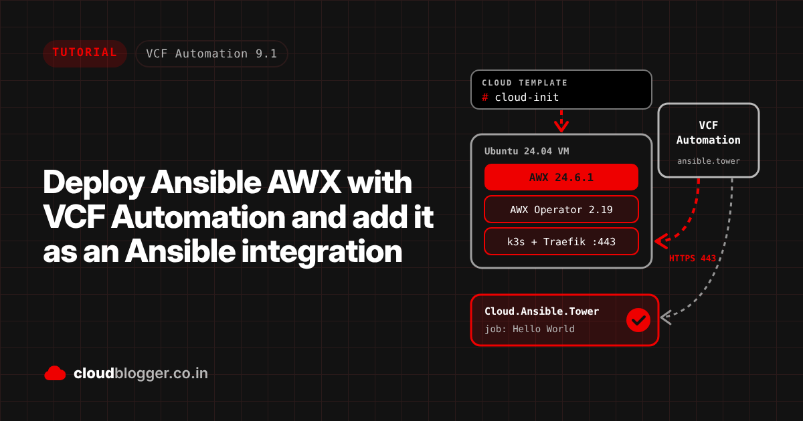

# Deploy Ansible AWX with VCF Automation and add it as an Ansible integration



Two VCF Automation 9 (VM Apps) cloud templates and two small helper scripts:

- **LAB - AWX - Ubuntu** turns a plain Ubuntu 24.04 VM into a working AWX server: k3s, the AWX Operator and AWX on HTTPS 443, all through cloud-init
- **LAB - Ansible Hello World - Ubuntu** deploys a test VM with a `Cloud.Ansible.Tower` resource, so VCF Automation adds it to an AWX inventory and runs an AWX job on it

Companion to the cloudblogger.co.in post *Deploy Ansible AWX with VCF Automation and add it as an Ansible integration*.

## What's inside

| Path | What it is | Where it runs |
| --- | --- | --- |
| `cloud-template/lab-awx-ubuntu.yaml` | Cloud template `LAB - AWX - Ubuntu` | VCF Automation |
| `cloud-template/lab-ansible-hello-world-ubuntu.yaml` | Cloud template `LAB - Ansible Hello World - Ubuntu` | VCF Automation |
| `guest-scripts/*.sh` | The five install scripts from the AWX template, as separate files for easy reading | Inside the AWX VM, written and run by cloud-init |
| `awx-setup/awx-setup-vcfa.sh` | Creates the AWX inventory, machine credential and job template the test template needs | Once, on the AWX VM (or any Linux box with `curl` and `jq`) |
| `orchestrator/getAwxInstallStatus.js` | Reads the install progress from the VM's guestinfo | Orchestrator, as a scriptable task or action |

There is no vRO package for this one: the only Orchestrator code is the short status script above.

### The guest scripts

You don't copy these anywhere. They are already inside `lab-awx-ubuntu.yaml` (`cloudConfig` > `write_files`); cloud-init writes them to `/usr/local/sbin` on first boot and runs them in this order from `runcmd`:

| Order | Script | What it does |
| --- | --- | --- |
| - | `awx-status.sh` | Helper used by the others: writes a line to `/var/log/awx-install.log` and to `guestinfo.awx.status` |
| 1 | `add-login-user.sh` | Creates the OS login user, so you can SSH in even if a later step fails |
| 2 | `set-static-ip.sh` | Static IP, DNS and search domain through netplan |
| 3 | `set-ntp-and-disk.sh` | NTP, and grows the root disk to the full size |
| 4 | `install-awx.sh` | k3s, AWX Operator, AWX instance behind Traefik on 443, wait and self-test |

If you change a script, change it in the template YAML; the files here are copies.

## Setup

1. In VCF Automation, create a cloud template from `cloud-template/lab-awx-ubuntu.yaml`. Check the input defaults (network tag, IPs, DNS, NTP), then version and release it.
2. Deploy it. AWX is ready about 10 minutes after the deployment completes; follow progress in `guestinfo.awx.status` (vCenter, or `orchestrator/getAwxInstallStatus.js`) or `/var/log/awx-install.log`.
3. Add the integration: **Infrastructure > Connections > Integrations > Add Integration > Ansible Automation Platform**, hostname = AWX name or IP (no `https://`, no port), user `admin`, accept the certificate.
4. On the AWX VM, run the setup script once:
   ```
   ssh awxadmin@<AWX IP>
   nano awx-setup-vcfa.sh      # paste the script, fill in the 4 lines at the top
   bash awx-setup-vcfa.sh
   ```
5. Create a cloud template from `cloud-template/lab-ansible-hello-world-ubuntu.yaml` and deploy it with the same `osUsername` / `osPassword` you put in the setup script. The AWX job runs right after the VM is created.

`imageRef` takes either a vCenter template name or an OVA URL, for example `https://cloud-images.ubuntu.com/noble/current/noble-server-cloudimg-amd64.ova`.

## Tested on

VCF Automation 9.1.1 (VM Apps organization) with its embedded VCF Operations Orchestrator 9.1.1 (build 25643527), vSphere 9, Ubuntu 24.04 from a vCenter template and from the Ubuntu cloud image OVA URL. AWX 24.6.1 via AWX Operator 2.19.1 on k3s v1.37.2+k3s1.

## Notes

- The integration only talks HTTPS on 443 and needs the API under `/api/v2/`. AWX has it; Ansible Automation Platform 2.5 moved it and Broadcom documents that the integration doesn't work with it ([KB 394498](https://knowledge.broadcom.com/external/article/394498/ansible-automation-platformansible-tower.html)).
- The operator's default config pulls `kube-rbac-proxy` from gcr.io, which no longer serves it. `install-awx.sh` points it at quay.io in the kustomization.
- Keep `hostVariables: |` as a YAML string ([KB 436313](https://knowledge.broadcom.com/external/article/436313/ansible-tower-deployments-failing-in-vcf.html)).
- `awx.vmw.lab` style names need a DNS record; the script tries a dynamic update, otherwise use the IP.
- Disclaimer: provided as is, without warranty. Test in a lab before using in production.
