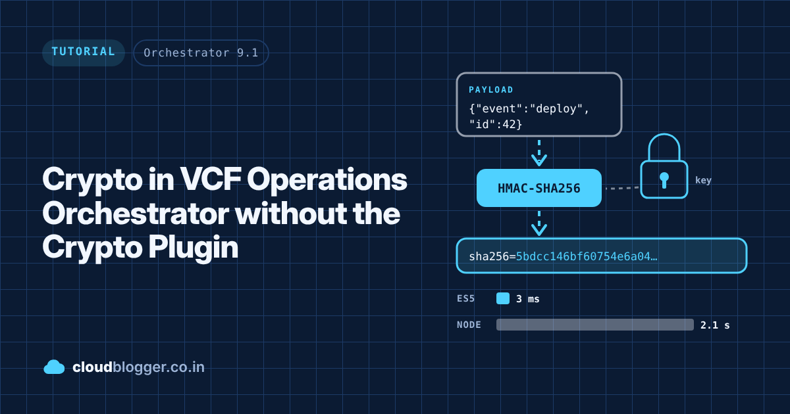

# Crypto for VCF Operations Orchestrator



Base64, SHA-1/256/512 and HMAC for Orchestrator (vRO) without the Crypto plugin, in two flavours:

- **ES5** (`in.co.cloudblogger.crypto`): plain ES5.1 scripting actions that run inline in Rhino. Fast for normal payloads, no action environment needed.
- **Node.js** (`in.co.cloudblogger.crypto.node`): polyglot actions on the `node:24` runtime using the built-in `crypto` module (OpenSSL), including authenticated AES-GCM encryption.

Companion to the cloudblogger.co.in post *Crypto in VCF Operations Orchestrator without the Crypto plugin*.

## What's inside

Package: `in.co.cloudblogger.crypto_v1.0.0_20261112.package` (both modules)

### ES5 module: `in.co.cloudblogger.crypto`

| Action | Returns | What it does |
| --- | --- | --- |
| `CryptoUtils` | class | UTF-8, hex, Base64/Base64URL, SHA-1/256/512, HMAC-SHA1/256/512, `verifyHmac`, `timingSafeEqual`, `randomBytes` |
| `AesCipher` | class | AES-128/192/256 CBC with PKCS#7 padding. **Lab/test use only** (see Notes) |
| `base64Encode` | string | UTF-8 text to Base64, or Base64URL when `urlSafe` is true |
| `base64Decode` | string | Base64 or Base64URL (padding optional) to UTF-8 text |
| `computeHash` | string | SHA-1/256/512 digest as hex, Base64 or Base64URL |
| `computeHmac` | string | HMAC-SHA1/256/512; key is a SecureString given as text, hex or Base64 |
| `verifyHmacSignature` | boolean | Constant-time check of a received signature; accepts `sha256=` style prefixes |

### Node.js module: `in.co.cloudblogger.crypto.node`

| Action | Returns | What it does |
| --- | --- | --- |
| `computeHash` | string | Same inputs and output as the ES5 `computeHash` |
| `computeHmac` | string | Same inputs and output as the ES5 `computeHmac` |
| `encryptAesText` | string | AES-GCM with a random 12-byte IV; returns Base64 of IV + ciphertext + 16-byte tag |
| `decryptAesText` | string | Decrypts and verifies a token from `encryptAesText`; throws if the key is wrong or the token was changed |

The `actions/` folder has every script as a plain `.js` file (`es5/` and `node/`), so you can read them without importing anything.

## Quick examples

```javascript
// ES5 class, inside any scriptable task
var CryptoUtils = System.getModule("in.co.cloudblogger.crypto").CryptoUtils();
var crypto = new CryptoUtils();

crypto.sha256("abc");                                   // "ba7816bf8f01cfea..."
crypto.hmac("SHA-256", webhookSecret, body, "base64");  // signature for a header
crypto.base64Encode("user:password");                   // Basic auth value
crypto.verifyHmac("SHA-256", webhookSecret, body, receivedSignature, "hex");
```

```javascript
// Node.js AES-GCM, called from a scriptable task like any other action
var node = System.getModule("in.co.cloudblogger.crypto.node");
var token = node.encryptAesText(aesKeyHex, "hex", "some text");
var plain = node.decryptAesText(aesKeyHex, "hex", token);
```

## Timings

Median times when called from a scriptable task, VCF Operations Orchestrator 9.1.1 lab:

| Payload | SHA-256 (ES5 / Node) | HMAC-SHA256 (ES5 / Node) | AES encrypt (ES5 CBC / Node GCM) | AES decrypt (ES5 CBC / Node GCM) |
| --- | --- | --- | --- | --- |
| 100 B | 1 ms / 2.1 s | 3 ms / 2.2 s | 5 ms / 2.1 s | 7 ms / 2.1 s |
| 10 KB | 79 ms / 2.1 s | 80 ms / 2.2 s | 406 ms / 2.1 s | 675 ms / 2.1 s |
| 100 KB | 846 ms / ~2 s | 862 ms / 2.2 s | 4.3 s / 2.1 s | 6.7 s / ~2 s |

Each Node.js call costs about 2.1 s regardless of payload (container start-up), and the very first call after the runtime has been idle took about 29 s. Use ES5 for hashing, HMAC and Base64; use Node.js when you need real encryption.

## Tested on

VCF Operations Orchestrator 9.1.1 (build 25643527), Node.js 24 polyglot runtime. ES5 results verified against NIST FIPS 180-4, RFC 2202, RFC 4231, FIPS-197 and SP 800-38A test vectors; ES5 and Node.js outputs match for hashing and HMAC.

## Notes

- `AesCipher` is hand-written: its table lookups are not constant-time and CBC has no integrity check. Use it to learn and test, not to protect real secrets. Use the Node.js AES-GCM actions, or SecureString attributes and configuration elements, for anything that matters.
- `randomBytes` takes its bytes from `System.nextUUID()`, not `Math.random()`.
- Keep keys in SecureString inputs or configuration elements, and don't log them.
- Polyglot actions return plain values, so the Node.js module has no classes, only the four actions.
- Disclaimer: provided as is, without warranty. Test in a lab before using in production.
