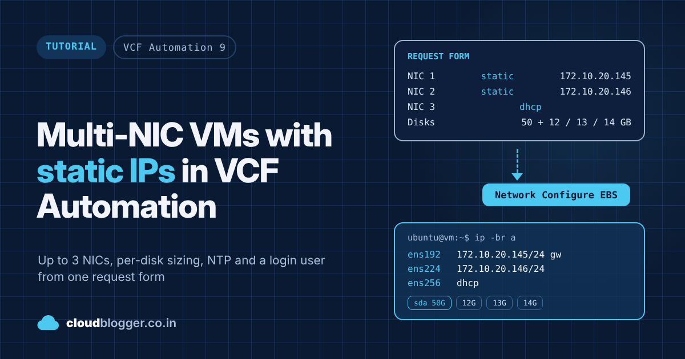

# Multi-NIC VMs with static IPs in VCF Automation

A VCF Automation 9 (VM Apps) cloud template, custom form and Orchestrator workflow that let one request build a VM with:

- up to 3 NICs, each optional, each static or DHCP
- a network dropdown per environment, mapped to `net:<name>` capability tags
- a boot disk size chosen by the requester
- any number of data disks, each with its own size
- NTP servers and an optional login user, set with cloud-init
- t-shirt sizes that show their CPU and RAM in the dropdown

Companion to the cloudblogger.co.in post *Multi-NIC VMs with static IPs in VCF Automation*.

## What's inside

| Path | What it is |
| --- | --- |
| `in.co.cloudblogger.multinic_v1.0.0_20261102.package` | vRO package: the workflow and both actions |
| `multi-nic-static-ip.vcfapkg` | [VCFA Ledger](https://github.com/imtrinity94/vcfa-ledger) package of the VCF Automation side. Open it in the [viewer](https://vcfa-ledger.vercel.app) |
| `cloud-template/cloud-template.yaml` | Cloud template `LAB - Ubuntu - Multi NIC Static IP` |
| `cloud-template/custom-form.yaml` | Custom request form (General, Storage and Network pages) |
| `workflow/apply-static-ip.js` | Script of `CloudBlogger - EBS - NetConf Pre - Apply Static IP` |
| `actions/getNetworksByEnvironment.js` | Fills the NIC network dropdowns |
| `actions/calculateCidrNotation.js` | IP + mask to CIDR, used by the workflow |
| `guest-scripts/template-netdiag.sh` | Read-only check of a Linux template (netplan, cloud-init, machine-id) |
| `guest-scripts/template-netfix.sh` | Seals a Linux template so NIC1 gets its static IP on clones |

Orchestrator objects in the package:

| Object | Name |
| --- | --- |
| Workflow | `CloudBlogger - EBS - NetConf Pre - Apply Static IP` (folder `CloudBlogger/Multi NIC Static IP`) |
| Action module | `in.co.cloudblogger.multinic` |
| Actions | `getNetworksByEnvironment`, `calculateCidrNotation` |

## Setup

1. Import the package in Orchestrator (**Assets > Packages > Import**).
2. Edit `networkCatalog` in `getNetworksByEnvironment` and tag each listed network `net:<name in lower case>` in your network profiles.
3. Create a cloud template from `cloud-template/cloud-template.yaml`, adjust the image and flavor names, then version and release it.
4. Create the subscription:

   | Setting | Value |
   | --- | --- |
   | Event topic | Network Configure |
   | Blocking | Yes |
   | Workflow | `CloudBlogger - EBS - NetConf Pre - Apply Static IP` |
   | Condition | `event.data.blueprintId == '<template id>' && event.data.customProperties.cpAnyStaticNic == 'Yes'` |

5. Import `cloud-template/custom-form.yaml` on the catalog item.
6. Run `guest-scripts/template-netdiag.sh` in your Linux template. If `/etc/netplan/` has a file that matches a MAC address, run `template-netfix.sh`, shut down and convert back to a template.

## Tested on

VCF Automation 9.1 (VM Apps organization) with its built-in VCF Operations Orchestrator 9.1.1 (build 25643527), and an Ubuntu 24.04.5 LTS template (cloud-init 26.1, open-vm-tools 13.0.10). Tested with three static NICs, a 50 GB boot disk, data disks of 12, 13 and 14 GB, NTP and a login user.

## Notes

- A network resource only accepts `count` 0 or 1, hence one resource per NIC.
- `allocatePerInstance: true` on the disk resource is what gives each data disk its own size.
- The boot disk can only be larger than the image disk.
- Only the first static NIC gets the default gateway.
- Don't use `"` or `\` in the VM password field.
- Don't combine `customizationSpec` with `cloudConfig` in the template.
- Disclaimer: provided as is, without warranty. Test in a lab before using in production.
